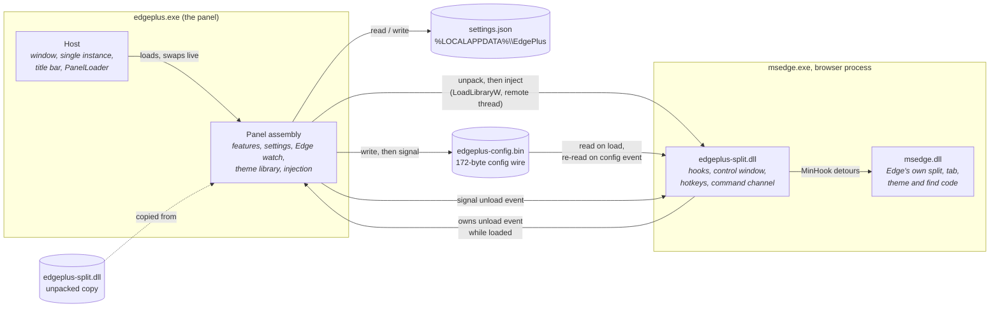
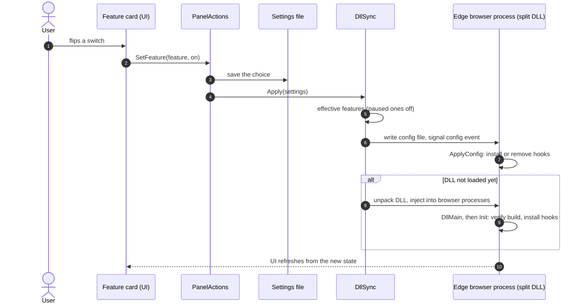
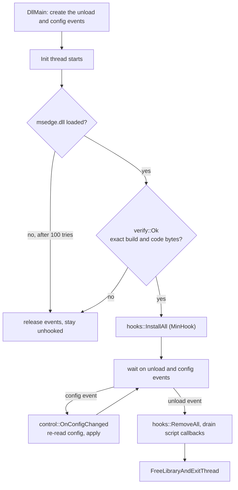

# Architecture

Edge+ changes Microsoft Edge without an extension. A small desktop panel
(the **host**) saves the user's choices and injects a DLL (the **split DLL**)
into Edge's browser process. The DLL hooks Edge's own code, so changes apply
live and are undone when the switch is turned off.

This document describes how the pieces fit. For what the user sees, see the
[README](README.md). For reverse-engineering notes on Edge's internals, see
[`docs/re/`](docs/re/).

## Contents

- [Components](#components)
- [Life of a change](#life-of-a-change)
- [The panel](#the-panel)
- [The split DLL](#the-split-dll)
- [Split model](#split-model)
- [Edge version pinning](#edge-version-pinning)
- [Design decisions](#design-decisions)
- [Where to start reading](#where-to-start-reading)

## Components



*The panel writes the settings and the config file, then injects or signals
the DLL. The DLL holds an unload event open for as long as it is loaded, so
the panel can tell whether it is running without tracking any process.*

| Part | Where | Language | Role |
|---|---|---|---|
| Core | `app/panel-tauri/src-tauri/src/` | Rust | Process, single instance, every feature, the settings, Edge watching, themes, injection, updates; the View the window renders. |
| Native calls | `app/panel-tauri/src-tauri/edge-native/` | Rust | Every Win32 / WinRT call the core makes; the only `unsafe`. |
| Window | `app/panel-tauri/ui/` | TypeScript / WinUI 3 | A Node process the core starts: draws the View, sends back Actions, one JSON line each way. |
| Split DLL | `app/native-split/` | C++20 | Runs inside Edge. Hooks, control window, hotkeys, tab drags. |
| Injector | `edge-native/src/process/inject.rs`, `app/native-split/src/inject.cpp` | Rust / C++ | The panel's injector; `inject.exe` is a development harness. |
| Reverse-engineering notes | `docs/re/` | Markdown | How each Edge hook was found and why it is safe. |

## Life of a change

Turning a switch on, end to end:



*A change is saved first, so it survives a restart. The DLL reads the same
state from the config file whether it was injected just now or was already
running.*

## The panel

### One process, a window only when asked

The host is a single process per user. A boot launch (`--background`) opens
no window and keeps the watchers running. Launching the app again, or clicking
its notification, opens the window in that same process.

### A window in its own process

The core is Rust; the window is WinUI 3 drawn from TypeScript through
dynwinrt's bindings, in a Node process the core starts with its stdin and
stdout as the link (`src-tauri/src/ui/window_host.rs`). The core sends the View
(`ui/protocol.rs`, exported to `ui/protocol.g.ts`) and the window answers with
Actions, so the window never touches settings, Edge or the DLL. A release exe
carries the window kit (Node, the bundled scripts, dynwinrt, the Windows App SDK
runtime) and unpacks it once per kit; the core installs the runtime for the user
when it is missing.

### Updating itself

Installed copies update the way a browser extension does through its update
URL. The repository hosts a small manifest, `docs/updates.json` (version, the
URLs of that release's exe and MSI, each one's SHA-256), written by
`tools/Release.ps1` once a release's files are attached. `update_watch` reads it
at start and every six hours (`update_feed` decides whether it names a newer
version), downloads the file this copy needs into `update\`, and checks it
against the digest. The window then shows its update card.

A portable copy downloads the exe, and **Restart to update** runs
`update_install`: the running exe is renamed aside (a running exe can be renamed,
not overwritten), the new one takes its name, and the new process is started
with `--restarted-from <pid>`, which makes it wait for the old process to exit
before it looks for a running panel to hand over to. The new exe then swaps its
own DLL into Edge, so Edge does not restart.

A copy the MSI installed (`app/installer`, which records its folder under
`HKLM\Software\EdgePlus`, read by `msi_install`) lives under Program Files, where
it cannot rename its own exe. It downloads the MSI instead, and **Restart to
update** starts a hidden PowerShell that waits for the panel to exit, runs the
MSI unattended (keeping only the shortcuts that still exist) and starts the
installed exe again.

Only a published exe does any of this, and the **Check for updates** switch
turns it all off.

### Upgrading from before the rename

The project was called fix-edge before it was Edge+. An install from then has
its split DLL loaded in Edge, listening on an event of the old name, and its
data in `%LOCALAPPDATA%\FixEdge`. At start, before anything is injected or read,
`LegacyInstall` signals the old event and waits for the DLL to unload, then
carries the data folder over (`LegacyData`; the settings are copied last, so a
copy cut short is retried). An Edge process the old DLL is still hooked in is
left alone until Edge restarts, since two DLLs would hook the same code.

### Watching Edge

`src-tauri/src/edge/edge_watch.rs` runs three checks:

- At start, and whenever a new browser process gets a window: it reads the
  `msedge.dll` build that process runs, and injects the DLL where the switches
  need it.
- Every two seconds: a process-list poll (`PollThread`).
- When the installed `msedge.exe` changes: a file watch, no polling.

### Features and their switches

Each feature is a value of `Feature` (`src-tauri/src/platform/settings.rs`). Each one
is either a switch in the DLL's config wire or something the panel does alone.

| Feature | Runs in | Notes |
|---|---|---|
| `NativeSplit` | DLL | Multi-pane split view and tab drags. |
| `Theming` | DLL + Edge | Picks the light or dark theme installed for Edge. |
| `QuietDevMode` | Panel only | Edits Edge's `Preferences` to hide the developer-mode prompt. |
| `ProtocolHandlers` | DLL | Lets a site's handler request be asked again. |
| `EnhancedFind` | DLL | RegExp and Copilot modes in Edge's find bar. |
| `WebUiFollowsTheme` | DLL | `edge://settings` and `edge://extensions` follow the theme. |
| `LivePreview` | DLL | Tab preview on hover. |
| `TabShape` | DLL | Cut-corner tabs. Needs `Theming`. |
| `ReadingTheme` | DLL | Reading mode follows Windows light and dark. |

### Themes

A theme is an extension package. The panel packs or reads it (`Themes/`,
`ThemePacker`, `Crx`) and records it under Edge's per-user external-extensions
registry key, `HKCU\Software\Microsoft\Edge\Extensions`. Edge's own loader then
installs it. No developer mode is needed. The DLL only chooses which installed
theme applies for the current Windows mode.

## The split DLL

### Load and unload



*The DLL refuses to hook any Edge build it does not know, before it changes
any code. Unloading restores Edge's own code and frees the library only after
Edge can no longer call into it.*

The unload event exists exactly while a DLL is loaded. That is how the panel
tells a live DLL from a stale one, so no per-process state is kept.

### Hooks

Each hook is a MinHook detour on a function in `msedge.dll`, placed by its
address (an RVA, given in `src/edge/offsets.h`). Every detour checks whether the
split is active and calls Edge's original code otherwise. A tab that is not in
a split runs exactly as Edge wrote it.

Hook pairs are named `h_name` (the detour) and `o_name` (the original it
calls). `hooks.h` installs them all in one place.

### Commands into the UI thread

Work that must run on Edge's UI thread is posted as a window message to a
window the DLL subclasses (`control.h`, `channel.h`). Hotkeys
(`Ctrl+Shift+Alt` + arrows) and the panel's config changes take the same path.
A script can post the same codes, which is how the test harness drives drags
and splits without clicks.

### Module map

| Area | Files | What it does |
|---|---|---|
| Edge access | `edge.h` | The only file that calls into `msedge.dll` or reads an Edge struct. |
| ABI | `offsets.h` | Every RVA and struct offset, named after the PDB symbol. |
| Build check | `verify.h` | Refuses any build the offsets were not reversed against. |
| Split model | `pane_tree.h`, `dock.h`, `geom.h` | Pure logic: the layout tree, drop zones, rectangles. No Edge, no Win32. |
| Split state | `state.h` | The tree of each split, keyed by its id. |
| Split data | `split_data.h`, `split_ops.h` | Grows, shrinks and rebuilds Edge's split through its own calls. |
| Geometry | `geometry.h`, `dividers.h`, `grip.h` | Lays out panes and their dividers and grips. |
| Tab list | `tabrows.h`, `tab_list.h`, `tab_views.h` | Shows a split's tabs in rows that follow the panes. |
| Tab drags | `tabdrag.h`, `drag.h` | Drags a tab into a split, Alt drops, and pane drags. |
| Tab look | `tab_shape.h`, `tab_edge.h`, `theme.h`, `theme_tone.h` | Cut corners and the theme's colours. |
| Find, links, handlers | `find.h`, `links.h`, `protocol_handlers.h` | The enhanced find bar, split links, handler prompts. |
| Repaint and motion | `repaint.h`, `anim.h`, `motion.h` | Forces panes to paint after a move; eases pane changes. |

## Split model

Edge's split view only ever holds two panes. The DLL grows it past two:

1. **The tree.** `pane_tree.h` keeps each split's layout as a tree of row and
   column nodes with weights. It is pure, so `app/native-split/test/` can test
   it without Edge.
2. **Edge's data.** The split's member tabs are the source of truth Edge uses
   to feed panes. `split_data.h` changes them through Edge's own
   `AddToSplitImpl` and `RemoveSplitImpl`, creating a new split under a new id
   each time, since Edge gives a changed split a new id.
3. **Geometry.** The `CalculateProposedLayout` detour (`geometry.h`) lays out
   the containers from the tree, so Edge places its own panes.
4. **The tab list.** Edge lays out a two-tab split as one row. `tabrows.h`
   spreads the rest over rows, ordered by where each pane sits on screen.

A tree is keyed by its split's id, not by the window (`state.h`), so a split
torn off into another window keeps its layout.

## Edge version pinning

Every hook is an address in one exact `msedge.dll`. So support is decided for
the whole build, not per feature:

- `offsets.h` pins the build the DLL was reversed against (currently
  156.0.4314.42).
- `verify.h` refuses to hook any other build.
- The panel's `EdgeSupport` pauses DLL-backed features on any other build. The
  user's choice is kept, and the features return by themselves once Edge+ is
  updated for that build.

When Edge updates, the work is to re-pin `offsets.h` and re-check each hook
with the tools in `docs/re/`.

## Design decisions

- **No extension.** An extension cannot change Edge's split view, its tab
  strip or its theme engine. A DLL runs inside Edge's process, so it can
  change them. Edge+ began as an extension that drew panes as frames in a page;
  panes in that page could not use Edge's own tab strip, split view or theme.
- **Live switches, not a restart.** Each switch sends the DLL its state
  through a config file and an event. Turning a feature off undoes its hooks
  and restores Edge's own behaviour.
- **Small, unhooked failure.** A build the DLL does not know, a missing module
  or a failed hook leaves Edge exactly as it was.
- **The panel is replaceable.** The host's load context lets the panel's code
  change while the window stays open, which speeds up development.
- **Pure logic is separate.** The split model, the drop zones and the settings
  format have no Edge or Win32 dependency, so they are unit-tested in
  `test/` for both the panel and the DLL.
- **One place per value.** Values shared by the panel and the DLL (event names,
  the config layout, the data folder) are declared once on the DLL side, and
  the core's `shared.g.rs` is generated from those markers
  (`tools/Export-SharedConstants.ps1`).

## Where to start reading

| To understand | Read |
|---|---|
| What a switch does at startup | `app/panel-tauri/src-tauri/src/dll/dll_sync.rs` |
| How the panel finds Edge's build | `app/panel-tauri/src-tauri/src/edge/edge_watch.rs` |
| How the DLL starts and stops | `app/native-split/src/dllmain.cpp` |
| The config the panel writes | `app/native-split/src/core/config.h`, `src-tauri/src/dll/config_wire.rs` |
| Which Edge functions are hooked | `app/native-split/src/edge/hooks.h` |
| How a split changes | `app/native-split/src/split/split_ops.h` |
| How a tab is dragged into a split | `app/native-split/src/chrome/tabs/tabdrag.h` |
| How an Edge function was found | `docs/re/` |

## Building and testing

```powershell
app\native-split\build.cmd              # the DLL (MSVC) -> build\edgeplus-split.dll
app\native-split\test\run.cmd           # the DLL's pure-logic tests
pnpm --dir app\panel-tauri build        # the panel, with the DLL and window kit embedded
pnpm --dir app\panel-tauri test         # the panel's tests (window and core)
pwsh tools\lint.ps1                     # clang-format, clang-tidy, the panel's linters
```

The panel's build embeds the DLL it was built with, so the DLL the panel injects
always matches its own version.
