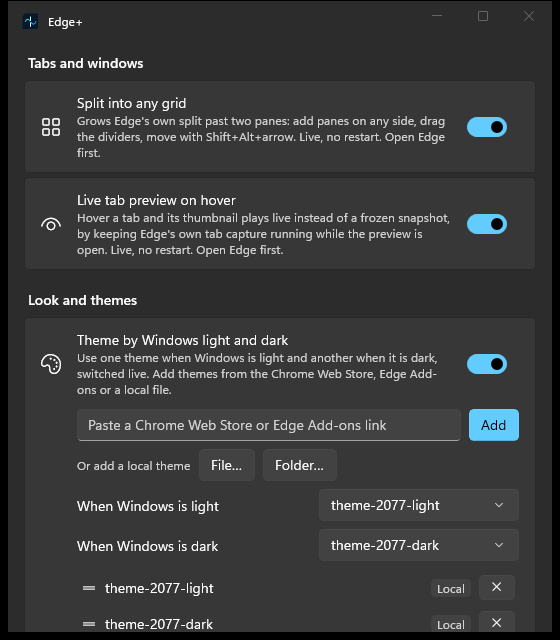
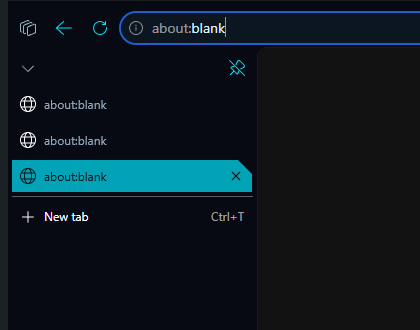

# Edge+

Live feature switches for Microsoft Edge. A desktop panel turns each feature on
or off, and Edge picks the change up the moment it is made — no restart, ever.



## Requirements

- Windows 10 version 2004 (build 19041) or later, 64-bit.
- Microsoft Edge (Stable, 64-bit) 155.0.4283.62, the one build the DLL is
  pinned to (`app/native-split/src/offsets.h`). On any other build every
  feature that calls into `msedge.dll` pauses itself and Edge is left
  untouched; see *Setup*.
- Run the panel as the same Windows user that runs Edge.

## Features

- **Split into any grid** — grows Edge's *own* split view past two panes, side by
  side or stacked, inside the tab itself; each tab keeps its own layout, the way
  Arc does it. Every pane has its own address bar, dividers drag, and a pane's ⋯
  menu adds a pane above / below / left / right. Loaded straight into Edge as a
  DLL — no extension (`app/native-split`, reverse-engineered in `docs/re/`).
- **Move between panes** — `Shift + Alt` + an arrow key focuses the pane on that
  side, in the split you are on.
- **Theme by Windows light and dark** — use one theme when Windows is in light
  mode and another when it is in dark, switched live when Windows flips, with no
  restart. Add themes from a Chrome Web Store / Edge Add-ons link or a local
  `.crx`; Edge's own theming engine paints them (the injected DLL only picks and
  applies the right one).
- **Cut-corner tabs** — with Theming on, every tab, in the vertical list and in
  the horizontal strip, gets a straight leading edge and a 45° cut on its
  trailing top corner, the selected tab is filled in the theme's neon, and a
  horizontal tab loses its flared feet. Edge's own outline is reshaped by the
  injected DLL, so nothing is painted over the tab (`app/native-split/src/tab_shape.h`).

  
- **Settings and extensions pages follow the theme** — `edge://settings` and
  `edge://extensions` take their light or dark from Windows or Edge's
  Appearance setting, never from the theme, so a dark theme on a light Windows
  leaves them white. With this on they follow the theme's own colors, live
  (including Theming's swap); a default-theme profile still follows Edge's
  Appearance setting. Only those two pages change; websites and every other
  Edge page keep what Edge decides (`docs/re/webui-color-scheme.md`). Runs in
  the injected DLL.
- **Hide the developer-mode prompt** — stops Edge asking to turn off
  developer-mode extensions at startup.
- **Ask to handle links, like Chrome** — when a site such as Gmail offers to
  open email or calendar links, Edge's address-bar handler icon stays an open
  question: closing its bubble or answering "Just this time" no longer blocks
  the site for good, and turning it on lifts the blocks already on record
  (Edge has no page for them) (`docs/re/protocol-handlers.md`). Runs in the
  injected DLL.
- **Enhanced find: RegExp and Ask Copilot** — Edge's own `Ctrl + F`
  bar gets two modes, chosen by what you type in its box: `/pattern/i` is a
  RegExp search (every match highlighted, counted in the bar's own n/m, Enter
  steps), and `? where do they discuss pricing?` asks Copilot and
  highlights the paragraphs it names. Anything else
  is Edge's own find, as are Edge pages and PDFs (`docs/re/find-bar.md`). Runs in
  the injected DLL.

Removed for now: the Gemini integration (Gemini in a side panel from the
toolbar chat button, with tab sharing). Copilot is the only assistant. The code
is in git history at `4ee5113`; the notes are in
`docs/re/removed-gemini-integration.md`.

## How it fits together

```
app/
  panel-winui/   the panel, WinUI 3 / C# (modelled on avi/any-stt): one switch
                 per feature, in titled sections; Native/ holds all its Win32
  native-split/  the C++ DLL the panel injects into Edge's browser process
```

The panel keeps the user's choices in `%LOCALAPPDATA%\FixEdge\settings.json` and
drives each feature directly. Every Win32 action — enumerating Edge's browser
processes, injecting (or ejecting) `fixedge-split.dll`, adding a theme through
Edge's external-extension loader, snoozing the developer-mode prompt — lives in
a `Native\` folder, the only place with a `[DllImport]`. The split DLL travels
inside the panel binary and is unpacked beside the settings, so the DLL always
matches the build. Started with Windows, the panel runs with no window and
watches for an Edge update (see `app/panel-winui/README.md`).

The split and the theming share one injected DLL, driven by a small config file
(`fixedge-config.bin`) the DLL re-reads whenever a named event is signalled.
Turning the split off breaks any split of three or more panes back into
standalone tabs first, so nothing Edge can't render on its own is left behind.

## Setup

```powershell
dotnet publish app\panel-winui -c Release    # one self-contained edgeplus.exe
```

Open the panel, open Edge, and flip the switches. There is no extension to load
and nothing to pre-install.

The split DLL is pinned to one `msedge.dll` build (`app/native-split/src/offsets.h`);
on any other build it refuses to hook and the split simply does nothing, so it is
always safe to leave on. The panel reads that build from `offsets.h` at compile
time and compares it with the `msedge.dll` each Edge browser process actually
loaded — at start, whenever a new browser process appears (which is how an
update's restart shows up) and whenever Edge's installed `msedge.exe` changes.
On any other build it pauses every feature that calls into `msedge.dll` (hiding
the developer-mode prompt only edits `Preferences` and keeps running), keeps the
user's choices so they apply again on a supported build, says so on each card
(and by one toast when the window is closed), and never injects into that Edge.

## Develop

The panel (C#; .NET 10 SDK, Windows App SDK 1.8; the dev loop, with the panel
swapped live on every rebuild, is in `app/panel-winui/README.md`):

```powershell
dotnet build app\panel-winui                 # -> bin\...\edgeplus.exe (builds the DLL if missing)
dotnet publish app\panel-winui -c Release    # one self-contained edgeplus.exe
app\panel-winui\test\run.cmd                 # the pure-logic unit tests
pwsh tools\lint.ps1                          # includes dotnet format + the C# house rules
```

The native split DLL:

```powershell
app\native-split\build.cmd       # -> build\fixedge-split.dll and inject.exe
app\native-split\test\run.cmd    # the pure-logic unit tests
pwsh tools\lint.ps1              # clang-format/-tidy for the C++
```

## License

Edge+ is free and open source under the [Apache License 2.0](LICENSE).

You may use, change and redistribute it, including in a fork or a product, as
long as you keep the [NOTICE](NOTICE) file, which credits the author, Avi
(<https://avi12.com>), and say what you changed. It comes with no warranty.

It reverse-engineers one build of a Microsoft product and is not affiliated
with Microsoft. "Microsoft Edge" is a trademark of Microsoft Corporation.
